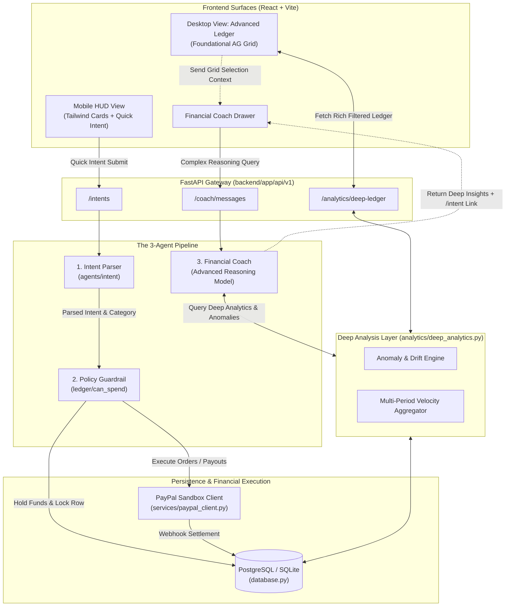

# Architecture Specification

This document details the system design, split monorepo architecture, database schema models, the foundational **Render** hosting architecture, the **AG Grid** desktop deep analytics layer, and the three-agent pipeline powering **FireWallet** (incorporating the **Trinity** bucket financial engine).

Related: [TOOL_STACK.md](TOOL_STACK.md), [TRINITY_RULES.md](TRINITY_RULES.md), [SETUP_GUIDE.md](SETUP_GUIDE.md), [insights.md](insights.md), [paypal_integration.md](paypal_integration.md).

---

## 1. Split Monorepo Architecture

FireWallet is organized as a clean, split monorepo separating asynchronous backend services from the dual-surface frontend:

```
Trinity/
├── docs/                             # Living product, architectural & tool specifications
│   ├── ARCHITECTURE.md               # This system design spec
│   ├── TOOL_STACK.md                 # Complete ecosystem & library directory
│   ├── TRINITY_RULES.md              # Mathematical rules for Bank/Daily/Freedom/Vault
│   ├── SETUP_GUIDE.md                # Local setup, PayPal sandbox & Render deployment
│   └── ...
├── render.yaml                       # Foundational Render deployment blueprint
├── backend/                          # FastAPI Asynchronous Service
│   ├── pyproject.toml                # uv package manager config
│   ├── alembic/                      # Database migrations
│   └── app/
│       ├── main.py                   # FastAPI lifespan, CORS, error handling
│       ├── database.py               # Dual-engine SQLModel database setup (SQLite / Postgres)
│       ├── core/                     # Settings, security & authentication dependencies
│       ├── api/v1/                   # Thin REST controllers (auth, intents, buckets, coach, bills, analytics)
│       ├── agents/
│       │   ├── intent/               # Agent 1: Intent Parser (parse why, categorize, fail-closed)
│       │   ├── insights/             # Agent 3: Financial Coach with Advanced Reasoning Model
│       │   └── shared/               # LLM client & structured JSON validation
│       ├── ledger/                   # Agent 2: Policy Guardrail & double-entry holds (can_spend)
│       ├── analytics/
│       │   ├── summary.py            # Basic HUD aggregations and chart series
│       │   └── deep_analytics.py     # Foundational Deep Analysis Layer (anomalies, velocity, drift)
│       ├── services/
│       │   └── paypal_client.py      # PayPal Sandbox REST client (Orders, Payouts, Webhooks)
│       ├── jobs/                     # Scheduled routines (morning top-up, bill sweeps)
│       ├── models/                   # SQLModel mapped database entities
│       └── schemas/                  # Pydantic request / response DTOs
└── frontend/                         # React + Vite + Tailwind CSS PWA
    ├── package.json                  # Frontend dependencies (including ag-grid-react)
    ├── vite.config.js                # Vite bundler configuration
    ├── tailwind.config.js            # Tailwind styling design tokens
    └── src/
        ├── app/                      # Shell layout, router & React Query provider
        ├── features/
        │   ├── hud/                  # Mobile Home HUD (Minimalist Tailwind cards for Trinity buckets)
        │   ├── intent/               # Quick Intent capture modal & PayPal approval redirect
        │   ├── coach/                # Insights Coach chat drawer
        │   ├── analytics/
        │   │   ├── ChartsView.jsx    # Responsive Tailwind visual charts (pie, sparklines)
        │   │   ├── DeepLedgerGrid.jsx# Foundational Desktop AG Grid "Advanced Ledger & Audit Log"
        │   │   └── DeepAnalyticsPage.jsx # Desktop Deep Analytics route
        │   ├── bills/                # Priority bill scheduler
        │   ├── override/             # Escape window (confession & countdown timer)
        │   └── settings/             # Trinity policy configuration sliders
        └── shared/                   # UI components, API fetch client & currency utilities
```

---

## 2. Dual-Surface Frontend Architecture

FireWallet provides two distinct, purposeful user interfaces built on the same React component tree:

### 2.1. Mobile-First HUD View (`/`)
- **Philosophy:** Minimalist, calm, thumb-driven interaction.
- **Components:**
  - **Tailwind Bucket Cards:** Clean cards for Bank foundation ($800.00 locked), Daily Allowance ($52.00 available with `+$12` rollover badge), safe Vault/Bills strip, and Freedom meter (60% remaining).
  - **Quick Intent FAB:** Persistent floating action button in the lower thumb zone for 1-tap spend logging.
  - **AI Chat Coach Drawer:** Slide-up sheet providing conversational advice without cluttering the screen.

### 2.2. Desktop Admin & Deep Analytics View (`/analytics/deep-ledger`)
- **Philosophy:** High-density, professional financial auditing and deep intelligence.
- **View Toggle:** A prominent "Advanced Ledger & Audit Log" / "Deep Analytics" tab accessible on desktop viewports or via navigation.
- **Foundational AG Grid Engine:**
  - Implements an enterprise data table rendering every transaction and ledger transfer.
  - Features multi-column sorting, granular date filtering, bucket segmentation (`bank`, `daily`, `freedom`, `vault`, `bills`), and transaction state grouping (`hold`, `posted`, `released`).
  - Displays full audit metadata: PayPal Order IDs, Capture IDs, and webhook receipt timestamps.
  - **"Analyze with Coach" Action:** Selecting rows or groups in AG Grid immediately sends the filtered context to the Financial Coach for deep reasoning.

---

## 3. The 3-Agent Pipeline & Deep Analysis Layer

The intelligence of FireWallet pairs proactive constraint enforcement with deep analytical reasoning:



### 1. Intent Parser (`app/agents/intent/`)
- Ingests the natural-language *why*, evaluates user context, and classifies spend into `category` and `necessity` (`daily_living`, `freedom`, `bill`, `ambiguous`). Fails closed on LLM downtime.

### 2. Policy Guardrail (`app/ledger/`)
- Deterministic rules engine (strictly code, NOT an LLM).
- Evaluates `can_spend()`: prevents unapproved Bank raids, locks Vault, protects Bills, and places atomic row-level `HOLD` locks before dispatching PayPal sandbox requests via `app.services.paypal_client.py`.

### 3. Financial Coach with Advanced Reasoning Model (`app/agents/insights/`)
- Powered by a high-capability reasoning model to resolve complex financial queries:
  - *"Why did my dining-out spending spike 45% this week compared to my 30-day average?"*
  - *"If I spend $60 this weekend, how will that affect my Daily rollover cushion heading into rent day?"*
  - *"Analyze the transactions currently filtered in my AG Grid table for recurring subscription drift."*
- Queries the **Deep Analysis Layer** (`app/analytics/deep_analytics.py`) to access calculated metrics:
  - **Spending Velocity:** Rates of daily envelope depletion across weeks.
  - **Bucket Drift:** Divergence between actual spending and target bucket allocations.
  - **Anomaly Detection:** Outlier identification relative to the user's historical baseline.
- **Strict Read-Only Guardrail:** Translates analytical intelligence into actionable guidance and 1-tap `/intent` links, but cannot trigger payments.

---

## 4. Foundational Cloud Deployment Architecture (Render)

Deployment on **Render** is a foundational architectural component ensuring high availability, sandbox webhook reliability, and qualification for the **Render Sponsor Prize**:

- **FastAPI Web Service (`firewallet-api`):** Runs the asynchronous Python backend, handles all API routes, and listens for inbound PayPal webhooks over a secure public HTTPS endpoint.
- **React Static Site (`firewallet-web`):** High-performance static build of the React + Vite frontend served via Render's global CDN.
- **Managed PostgreSQL Database (`firewallet-db`):** Cloud relational store maintaining double-entry ledger entries, bucket balances, policies, and audit logs.
- **Live Submission URL:** Every submission includes the active Render production URL on Devpost.

---

## 5. Modern Data Layer & Tooling Foundation

### 5.1. SQLModel ORM Architecture
The data tier is unified using modern **SQLModel** (unifying SQLAlchemy 2.0 Async with Pydantic v2):
- **Tripartite Model Pattern:**
  - `*Base(SQLModel)`: Encapsulates business fields, data types, and validation constraints.
  - `*(Base, table=True)`: Persistent relational tables with UUID primary keys, foreign keys, indexes, and table definitions.
  - `*Read(Base)` / `*Update(SQLModel)`: Type-safe API serialization models ensuring clean contracts without schema leakage.
- **Strict Pydantic v2 Conventions:**
  - Deprecated `.dict()` calls are completely eliminated; serialization strictly uses `.model_dump()` and `.model_dump_json()`.
  - Deprecated `datetime.utcnow()` is replaced across all models with timezone-aware `datetime.now(timezone.utc)` (via helper `utc_now()`).
- **Pure Asynchronous Engine:**
  - Configured via `create_async_engine` and `async_sessionmaker(class_=AsyncSession)` in `app/database.py`.
  - Single codebase supports SQLite (`aiosqlite`) for zero-config local development and PostgreSQL (`asyncpg`) for production on Render.

### 5.2. Tooling & Package Management Foundation
- **`uv` (Python 3.12+):** High-speed Rust-based package manager and environment coordinator. Governs `backend/pyproject.toml` and deterministic dependency locking via `backend/uv.lock`.
- **`npm` & `fnm` (Node.js 20+):** Pinned via `.node-version`. Delivers fast HMR development and optimized static bundling for Render.

