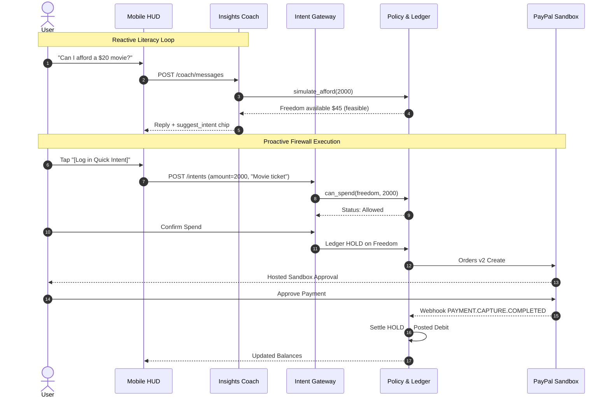

# Workflows

End-to-end user journeys and system lifecycles for **FireWallet**.

Related: [trinity_logic.md](trinity_logic.md), [agent_design.md](agent_design.md), [insights.md](insights.md), [paypal_integration.md](paypal_integration.md), [api_contracts.md](api_contracts.md).

---

## 1. Onboarding & Setup

```
Install PWA → Login with PayPal (sandbox) → create user in PostgreSQL
  → set timezone, currency USD
  → set Trinity policy (vault_skim_bps, daily_amount, freedom_monthly)
  → optional: link accountability partner email
  → initialize Trinity buckets (Bank, Daily, Freedom, Vault, Bills) at 0
  → add upcoming bills (rent, utilities)
  → seed or wait for initial payday
```

If PayPal Identity is not configured, seed scripts pre-link a sandbox buyer for judge evaluation.

---

## 2. Payday (Income Settlement & Skim)

**Trigger:** PayPal payout to user sandbox account, or scheduled income webhook.

```
PayPal webhook arrives: PAYMENT.PAYOUTSBATCH.SUCCESS or PAYMENT.CAPTURE.COMPLETED
  → Record event in paypal_webhook_events (idempotent ON CONFLICT DO NOTHING)
  → Ledger: Credit Bank bucket (gross amount)
  → Policy Engine computes:
      skim = floor(gross * vault_skim_bps / 10000)
      bill_reserve = sum of bills due before next payday
      (If skim + bill_reserve > gross: Bills take priority, Vault gets remainder)
  → Ledger HOLD on Bank for Vault skim + Payout to Vault sandbox receiver
  → Ledger: Bank → Vault (posted), Bank → Bills reserve
  → If calendar month start and Freedom unfilled: Bank → Freedom
  → HUD updates immediately
```

---

## 3. Morning Daily Top-Up (Rollover Rule)

**Trigger:** User-local midnight cron, or first app launch of the local day.

```
Check daily_runs table for (user_id, local_date, 'daily_topup')
  → If already ran: no-op
  → If Daily available >= policy.daily_amount:
      No top-up needed; full rollover remains intact!
  → If Daily available < policy.daily_amount:
      shortfall = policy.daily_amount - Daily.available
      transfer = min(shortfall, Bank.available)
      Ledger: Transfer transfer from Bank → Daily
  → Record daily_runs entry
  → HUD displays positive rollover banner: "+$X rolled over"
```

---

## 4. Intent Spend (Allowed Path — Everyday Living)

```
User taps Quick Intent FAB on HUD
  → Enters $24.00, "Buying groceries at Trader Joe's"
  → POST /intents
  → Intent Agent parses: category='groceries', necessity='daily_living', bucket='daily'
  → Policy Engine evaluates: can_spend(daily, $24.00) = ALLOW
  → API returns status='allowed' with rationale
User reviews and taps "Pay with PayPal"
  → POST /intents/{id}/execute
  → Ledger: Takes row lock (SELECT FOR UPDATE) and places HOLD on Daily bucket
  → PayPal: POST /v2/checkout/orders (intent=CAPTURE)
  → User redirected to PayPal sandbox checkout modal
User approves payment in sandbox
  → Return to PWA: POST /intents/{id}/capture
  → PayPal processes capture
  → Webhook: PAYMENT.CAPTURE.COMPLETED verified
  → Ledger: Converts HOLD to settled posted debit
  → Daily balance decrements on HUD
```

---

## 5. Intent Spend (Denied Path — Impulse Blocked)

```
User taps Quick Intent FAB
  → Enters $35.00, "Late-night sushi delivery", 1:30 AM
  → Daily available: $8.00 | Freedom available: $0.00
  → POST /intents
  → Intent Agent parses: category='eating_out', necessity='freedom', bucket='freedom'
  → Policy Engine evaluates: can_spend(freedom, $35.00) = DENY (freedom depleted)
  → Policy Engine checks fallback: Bank spend requires override
  → API returns status='needs_override' with explanation:
      "Freedom envelope is empty for this month. Bank funds are reserved for rent."
  → PayPal button is NOT rendered; user is shown the "Escape Window" button
```

---

## 6. Escape Window (Friction Override)

```
User elects to proceed despite the firewall block
  → Navigates to /override/:id
  → Confession: User must type at least override_min_chars (e.g. 200 chars) explaining why
  → POST /overrides { intent_id, body }
  → Server verifies body length and starts cooldown timer:
      ready_at = now() + override_cooldown_seconds (e.g. 180s)
  → HUD/Screen displays live countdown timer; execute requests return 409
  → If partner 2FA required: system emails single-use magic token to partner
  → When cooldown elapses AND partner approves (if required):
      Override status becomes 'approved'
  → User can now execute: Ledger HOLD on Bank → PayPal Order created
```

---

## 7. Fixed Bill Payment

```
Scheduled sweep job checks bills due today
  → Sorts by priority (1 = Rent, 2 = Water, etc.)
  → Earmarks funds from Bills bucket (falling back to Bank if needed)
  → Never pulls from Daily, Freedom, or Vault
  → Executes PayPal Payout to bill payee sandbox email
  → Webhook PAYMENT.PAYOUTSBATCH.SUCCESS marks bill 'paid'
```

---

## 8. Coach Affordability Simulation (`simulate_afford`)

```
User opens Insights Coach dock on HUD
  → Asks: "Can I afford a $20 movie ticket tonight?"
  → POST /coach/messages { utterance: "Can I afford a $20 movie ticket tonight?" }
  → Insights Coach calls read-only tool: simulate_afford(amount_minor=2000, category="entertainment")
  → Analytics layer queries PostgreSQL ledger:
      Freedom available: $45.00
      Daily available: $15.00
      Projected Freedom after spend: $25.00 (within budget)
  → Insights Coach returns reply:
      "Yes! You have $45 remaining in Freedom. Spending $20 leaves $25 for the rest of the month without affecting groceries or rent."
  → Returns suggest_intent payload:
      { utterance: "Movie ticket", amount: 2000, category: "entertainment", target_bucket: "freedom" }
  → Coach UI renders 1-tap chip: "[Log in Quick Intent →]"
```

---

## 9. Chart-Tap Literacy Explanation (`chart_id`)

```
User views HUD 7-Day Category Spend Pie Chart (chart_pie_week)
  → User taps "Ask Coach about this chart"
  → Coach drawer slides open with pre-filled context
  → POST /coach/messages { utterance: "What does this pie chart mean?", chart_id: "chart_pie_week" }
  → Insights Coach calls read-only tool: get_chart_context("chart_pie_week")
  → Analytics layer returns category amounts and percentages:
      Groceries: 66.7% ($80.00), Dining Out: 33.3% ($40.00)
  → Insights Coach synthesizes plain-English explanation:
      "This chart breaks down where your Daily Allowance went this week. Two-thirds went toward groceries and one-third toward eating out. You have stayed comfortably within your $40 daily target."
  → Response includes citations: { buckets: ["daily"], range: "7d" }
```

---

## 10. Coach $\rightarrow$ Intent Handoff

```
User taps the "[Log in Quick Intent →]" action pill generated by the Coach
  → PWA navigates to /intent with pre-populated query parameters:
      amount=2000&utterance=Movie+ticket&category=entertainment
  → Quick Intent modal opens with fields populated
  → User simply taps "Check with Firewall"
  → Standard Intent-First Gateway pipeline runs (Agent parse → Policy check → Ledger HOLD → PayPal)
  → Coach NEVER executes the transaction directly; full firewall protection is maintained
```

---

## Sequence Diagram: Spend vs. Coach Handoff


