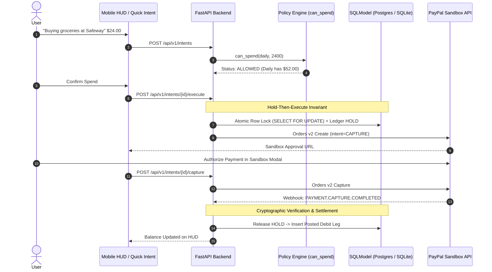

# FireWallet 🔥💳

> **A Proactive Financial Firewall & AI Coach built on the Trinity Bucket Architecture for the [PayPal AI Hackathon](https://paypalaihackathon.devpost.com/).**

[](https://developer.paypal.com)
[](https://astral.sh/uv)
[](https://fastapi.tiangolo.com)
[](https://sqlmodel.tiangolo.com)
[](https://nodejs.org)
[](https://react.dev)
[](https://www.ag-grid.com)
[](./postman_collection.json)

---

## 💡 The Problem: Why Traditional Budgeting Fails

Most personal finance apps perform **"financial autopsies"**: they send a push notification *after* you have already overspent on a 1:00 AM delivery order. 

Under one-tap checkout pressure, consumers spend from a single blended PayPal balance that inadvertently consumes capital reserved for rent and utilities. When your daily cash is exhausted, nothing stops you from draining your rent fund.

---

## 🛡️ The Solution: What is FireWallet?

**FireWallet** is an intent-first financial firewall:
1. **Trinity Bucket Engine:** Liquidity is partitioned into **Bank** (foundation cash flow), **Daily Allowance** (living engine with compound rollover), **Freedom** (guilt-free discretionary hedonism), and **Vault** (20% locked savings).
2. **Intent-First Gateway:** No PayPal payment is authorized until the user states *why* they are spending. An AI **Intent Parser** classifies the necessity and evaluates deterministic policy rules.
3. **The Escape Window:** Raiding your Bank foundation for non-bills requires an **Escape Window** override: a mandatory 200-character written reflection and a server-enforced 3-minute cooldown timer. There is no one-click bypass.
4. **Dual-Surface Frontend:**
   - **Mobile HUD (`/`):** A minimalist, thumb-friendly Heads-Up Display featuring Tailwind cards, live rollover badges, and a Quick Intent floating action button.
   - **Desktop Deep Ledger (`/analytics/deep-ledger`):** An enterprise audit log powered by **AG Grid**, featuring multi-column sorting, transaction state grouping, and direct interrogation by our AI Coach.
5. **Advanced Reasoning Coach:** A reactive financial mentor answering plain-English affordability queries (*"Can I afford a $20 movie ticket tonight?"*), explaining visual charts (`chart_id`), and diagnosing spending velocity from active AG Grid filter states.

---

## 🔒 Securing the Backend with PayPal Sandbox & Developer Tooling

FireWallet does not use mock balances or cosmetic checkouts. The entire money-movement lifecycle is enforced through the **PayPal Sandbox Platform** (`api-m.sandbox.paypal.com`):



### Key Security & Integrity Invariants
- **Hold-Then-Execute Architecture:** Before calling PayPal's Orders API, the backend locks the source bucket row (`SELECT ... FOR UPDATE`) and places a ledger `HOLD`. If payment fails or expires, the hold is released. Never is a debit posted prematurely.
- **Cryptographic Webhook Signature Verification:** Incoming webhooks on `/api/v1/webhooks/paypal` are verified against `PAYPAL_WEBHOOK_ID` using PayPal's `/v1/notifications/verify-webhook-signature` API. Spoofed transmissions are rejected with HTTP 400.
- **Webhook Idempotency:** Duplicate webhook events are discarded through a primary key constraint on `paypal_webhook_events.event_id`, returning HTTP 200 without duplicate ledger entries.
- **Zero-Float Accounting:** All monetary values are strictly represented in 64-bit integer minor units (`BIGINT` cents). Currency floats are prohibited to eliminate rounding exploits. Decimal strings are formatted via integer arithmetic only at the PayPal boundary (`f"{cents // 100}.{cents % 100:02d}"`).
- **Restricted Payout Destinations:** Automated Vault skims (20% on payday) and scheduled bill disbursements use PayPal's **Payouts API**, sending funds strictly to pre-registered merchant and receiver accounts—never arbitrary client-supplied emails.

---

## 📐 Elimination of Code Hallucinations with APIMatic

To ensure seamless integration between the asynchronous FastAPI backend, the React frontend, and external PayPal APIs, FireWallet leverages **APIMatic**:
1. **OpenAPI Standardization:** The live FastAPI backend exports a strictly validated OpenAPI schema to [`docs/openapi.json`](./docs/openapi.json).
2. **Context Feeding for Cursor & AI Agents:** The APIMatic portal is used to generate typed context specifications. These contracts are referenced during AI-assisted code generation, ensuring that every route handler, request body, and response model strictly adheres to verified schemas.
3. **Dual SDK Support:** Client SDK contracts generated via APIMatic synchronize data models between the Python backend and React frontend without manual typing drift.

---

## 📊 Foundational Desktop Workbench with AG Grid (AG Grid Sponsor Prize)

While mobile interactions prioritize a minimalist, thumb-friendly Heads-Up Display, desktop users unlock the **Foundational Deep Analytics & Advanced Ledger Workbench** (`/analytics/deep-ledger`):
- **Enterprise AG Grid Component:** High-density data grid featuring multi-column simultaneous sorting, granular date/category filtering, and transaction state grouping (`hold`, `posted`, `released`).
- **Audit Compliance:** Inspects raw transaction metadata including `transfer_id`, `paypal_order_id`, and `paypal_capture_id`.
- **"Analyze with Coach" Action:** Selecting rows or filtered categories in AG Grid passes the active grid state directly to our **Advanced Reasoning Coach**, which diagnoses spending velocity and detects rolling anomalies.
- **One-Click Export:** Instant CSV and JSON export for auditing.

---

## 🚀 Instant Smoke-Testing with Postman

A pre-configured Postman Collection is located at the root of the repository:
👉 **[`postman_collection.json`](./postman_collection.json)**

### How to Run in Postman:
1. Open Postman $\rightarrow$ Click **Import** $\rightarrow$ Select `postman_collection.json`.
2. Ensure the collection variable `baseUrl` is set to `http://localhost:8000`.
3. Execute the automated test folder to verify:
   - System Health (`GET /health`)
   - Trinity Bucket Balances (`GET /api/v1/buckets`)
   - Allowed Intent Parse (`POST /api/v1/intents` with $24.00 Groceries)
   - Denied Intent Firewall (`POST /api/v1/intents` with $35.00 Takeout)
   - Escape Window Confession & Cooldown (`POST /api/v1/overrides`)
   - Coach Affordability & Chart Literacy (`POST /api/v1/coach/messages`)
   - Desktop Deep Ledger Query (`GET /api/v1/analytics/deep-ledger`)

---

## 🛠️ Local Development & Quick Start

FireWallet is engineered around modern developer tooling: **`uv`** as the foundational high-performance Python package and virtualenv manager, and **`npm`** (pinned with `fnm`) for the frontend.

### 1. Prerequisites
- **Python 3.12+** (managed via **`uv`**)
- **Node.js 20+** (managed via **`npm`** and `fnm` / `nvm`)
- PayPal Developer Sandbox Account ([developer.paypal.com](https://developer.paypal.com))

### 2. Backend Setup
```powershell
cd backend

# Option A: Core Recommended Flow with uv
uv sync
uv run python -m app.jobs.seed
uv run uvicorn app.main:app --reload --port 8000

# Option B: Standard pip fallback
python -m venv .venv
.venv\Scripts\activate   # Windows
# source .venv/bin/activate  # macOS/Linux
pip install -e .
python -m app.jobs.seed
uvicorn app.main:app --reload --port 8000
```
API Documentation will be live at `http://localhost:8000/docs`.

### 3. Frontend Setup
```powershell
cd frontend
fnm use 20   # ensure Node 20+
npm install
npm run dev
```
Access the Mobile HUD at `http://localhost:5173`. Use browser DevTools (F12) in mobile device mode to experience the phone PWA, or toggle the top switcher to explore the desktop AG Grid view.

---

## 📚 Complete Documentation Index (`docs/`)

| Document | Description |
| :--- | :--- |
| **[docs/TOOL_STACK.md](./docs/TOOL_STACK.md)** | Master ecosystem directory (FastAPI, SQLite/Postgres, React/Tailwind, PayPal Sandbox, AG Grid, Postman, APIMatic). |
| **[docs/architecture.md](./docs/architecture.md)** | System design, split monorepo layout, SQLModel schemas, and the 3-agent pipeline. |
| **[docs/TRINITY_RULES.md](./docs/TRINITY_RULES.md)** | Mathematical specifications for Bank, Daily Rollover, Freedom, Vault, and Escape Window. |
| **[docs/SETUP_GUIDE.md](./docs/SETUP_GUIDE.md)** | Step-by-step local setup, PayPal sandbox credentials, and environment guide. |
| **[docs/insights.md](./docs/insights.md)** | Financial Coach Advanced Reasoning Model, chart literacy loops (`chart_id`), and AG Grid queries. |
| **[docs/paypal_integration.md](./docs/paypal_integration.md)** | PayPal Sandbox REST API mappings (Orders v2, Payouts, Identity, Webhook verification). |
| **[docs/api_contracts.md](./docs/api_contracts.md)** | REST JSON schemas, DTOs, deep ledger parameters, and error responses. |
| **[docs/frontend.md](./docs/frontend.md)** | Dual-surface UI design (Minimalist Mobile HUD + Desktop AG Grid Workbench). |
| **[docs/security.md](./docs/security.md)** | Secret management, cryptographic webhook validation, and read-only AI guardrails. |
| **[docs/demo_script.md](./docs/demo_script.md)** | Storyboard and timing script for the sub-3-minute hackathon video. |
| **[docs/decisions.md](./docs/decisions.md)** | Architectural Decision Records (ADRs 001 through 019). |
| **[docs/hackathon_overview.md](./docs/hackathon_overview.md)** | Hackathon rules, judging criteria, and prize targeting strategy. |

---

## ⚖️ License

FireWallet is open-source software licensed under the [MIT License](./LICENSE). Built with pride for the PayPal AI Hackathon.
