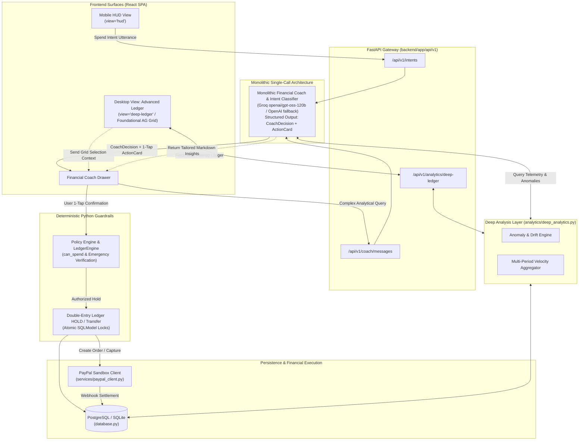

# Architecture Specification

This document details the system design, split monorepo architecture, database schema models, the **Render** hosting architecture, the **AG Grid** desktop deep analytics layer, and the Monolithic Single-Call Agent Architecture powering **FireWallet** (incorporating the **Trinity** bucket financial engine).

Related: **[problems.md](problems.md) (Core Build & Verification Gate)**, [TOOL_STACK.md](TOOL_STACK.md), [TRINITY_RULES.md](TRINITY_RULES.md), [SETUP_GUIDE.md](SETUP_GUIDE.md), [insights.md](insights.md), [paypal_integration.md](paypal_integration.md).

> [!IMPORTANT]
> **Core Build Gate & Architecture Verification ([problems.md](problems.md)):**
> Every component change, database migration, and cloud configuration must be verified against the prioritized issues and "Done when" tests in **[problems.md](problems.md)** (specifically Problem 1 for PayPal end-to-end execution, Problem 2 for judge-proof Render/Postgres deployment, and Problem 4 for live AI visibility).

---

## 1. Split Monorepo Architecture

FireWallet is organized as a clean, split monorepo separating asynchronous backend services from the dual-surface frontend:

```
Trinity/
├── docs/                             # Living product, architectural & tool specifications
│   ├── problems.md                   # Core build gate, honest review & prioritized action plan
│   ├── architecture.md               # This system design spec
│   ├── TOOL_STACK.md                 # Complete ecosystem & library directory
│   ├── TRINITY_RULES.md              # Mathematical rules for Bank/Daily/Freedom/Vault
│   ├── SETUP_GUIDE.md                # Local setup, PayPal sandbox & Render deployment
│   └── ...
├── render.yaml                       # Render cloud deployment blueprint
├── backend/                          # FastAPI Asynchronous Service
│   ├── pyproject.toml                # uv package manager config
│   ├── alembic/                      # Database migrations
│   └── app/
│       ├── main.py                   # FastAPI lifespan, CORS, error handling
│       ├── database.py               # Dual-engine SQLModel database setup (SQLite / Postgres)
│       ├── core/                     # Settings, security & authentication dependencies
│       ├── api/v1/                   # Thin REST controllers (auth, intents, buckets, coach, bills, analytics, paypal)
│       ├── agents/
│       │   ├── intent/               # Intent classification gateway (NLP parse why, categorize, fail-closed)
│       │   ├── insights/             # Monolithic Financial Coach (CoachDecision + RAG short-tags)
│       │   └── shared/               # Unified LLM client (Groq cascade -> OpenAI fallback -> offline heuristic)
│       ├── ledger/                   # Deterministic Policy Guardrail & double-entry holds (can_spend)
│       ├── analytics/
│       │   ├── summary.py            # Basic HUD aggregations and chart series
│       │   └── deep_analytics.py     # Foundational Deep Analysis Layer (anomalies, velocity, drift)
│       ├── services/
│       │   └── paypal_client.py      # PayPal Sandbox REST client (Orders, Payouts, Webhooks)
│       ├── jobs/                     # Scheduled routines (morning top-up, bill sweeps)
│       ├── models/                   # SQLModel mapped database entities
│       └── schemas/                  # Pydantic request / response DTOs
└── frontend/                         # React + Vite + Tailwind CSS PWA
    ├── package.json                  # Frontend dependencies (including ag-grid-react)
    ├── vite.config.js                # Vite bundler configuration
    ├── tailwind.config.js            # Tailwind styling design tokens
    └── src/
        ├── app/                      # Shell layout, router & React Query provider
        ├── features/
        │   ├── hud/                  # Mobile Home HUD (Minimalist Tailwind cards for Trinity buckets)
        │   ├── intent/               # Quick Intent capture modal & PayPal approval redirect
        │   ├── coach/                # Insights Coach chat drawer
        │   ├── analytics/
        │   │   ├── ChartsView.jsx    # Responsive Tailwind visual charts (pie, sparklines)
        │   │   ├── DeepLedgerGrid.jsx# Foundational Desktop AG Grid "Advanced Ledger & Audit Log"
        │   │   └── DeepAnalyticsPage.jsx # Desktop Deep Analytics route
        │   ├── bills/                # Priority bill scheduler
        │   ├── override/             # Escape window (confession & countdown timer)
        │   └── settings/             # Trinity policy configuration sliders
        └── shared/                   # UI components, API fetch client & currency utilities
```

---

## 2. Dual-Surface Frontend Architecture

FireWallet provides two distinct, purposeful user interfaces built on the same React component tree:

### 2.1. Mobile-First HUD View (`/`)
- **Philosophy:** Minimalist, calm, thumb-driven interaction.
- **Components:**
  - **Tailwind Bucket Cards:** Clean cards for Bank foundation ($800.00 locked), Daily Allowance ($52.00 available with `+$12` rollover badge), safe Vault/Bills strip, and Freedom meter (60% remaining).
  - **Quick Intent FAB:** Persistent floating action button in the lower thumb zone for 1-tap spend logging.
  - **AI Chat Coach Drawer:** Slide-up sheet providing conversational advice without cluttering the screen.

### 2.2. Desktop Admin & Deep Analytics View (`view='deep-ledger'`)
- **Philosophy:** High-density, professional financial auditing and deep intelligence.
- **In-App View Toggle:** A prominent "Deep Ledger" / "Mobile HUD" navigation toggle in the header dynamically switches surfaces within the SPA (`view='hud'` vs `view='deep-ledger'`).
- **Foundational AG Grid Engine:**
  - Implements an enterprise data table rendering every transaction and ledger transfer.
  - Features multi-column sorting, granular date filtering, bucket segmentation (`bank`, `daily`, `freedom`, `vault`, `bills`), and transaction state grouping (`hold`, `posted`, `released`).
  - Displays full audit metadata: PayPal Order IDs, Capture IDs, and webhook receipt timestamps.
  - **"Analyze with Coach" Action:** Selecting rows or groups in AG Grid immediately sends the filtered context to the Financial Coach for deep reasoning.

---

## 3. Monolithic Single-Call Architecture & Deep Analysis Layer

The intelligence of FireWallet pairs proactive constraint enforcement with deep analytical reasoning:



### 1. Monolithic Agent (`CoachDecision` + 1-Tap Action Cards)
- Consolidates natural-language spend intent classification, RAG short-tag memory retrieval, and reactive financial literacy coaching into a **single, ultra-fast LLM call** powered by Groq (`openai/gpt-oss-120b` primary, `gpt-4o-mini` fallback, and offline deterministic heuristics).
- Emits structured JSON adhering to `CoachDecision`, pre-packaging executable 1-tap `ActionCard` buttons directly to the user.

### 2. Deterministic Guardrails (`app/ledger/`)
- Deterministic rules engine (strictly Python code, NOT an LLM).
- Evaluates `can_spend()`: prevents unapproved Bank raids, protects Bills reservations, verifies emergency classifications before unlocking Vault Emergency Reserves, and enforces atomic row-level `HOLD` locks before dispatching PayPal sandbox requests via `app.services.paypal_client.py`.
- **PayPal Real-Time Account Routing Boundary**: Reconciles external PayPal APIs with internal double-entry bookkeeping (detailed in [docs/paypal_integration.md](paypal_integration.md#real-time-paypal-account-routing-architecture)):
  - **Orders v2 Buyer Checkout**: Omits explicit `payee` in `purchase_units[0]`, defaulting payee routing to the API developer merchant account (`PAYPAL_CLIENT_ID`).
  - **Internal Envelope Transfers**: Reallocations between Bank, Daily, Freedom, Vault, and Bills execute purely on-ledger via `LedgerEngine.record_double_entry_transfer` with zero external float and no external PayPal calls.
  - **Emergency Disbursements**: Verified emergencies draw from Vault (cascading to Bank if needed) with 0s cooldown bypass, routing directly to the emergency provider or recipient.
  - **Payouts API**: Routes outbound transfers explicitly via `items[0].receiver` to target email addresses (Vault skim to `PAYPAL_VAULT_RECEIVER_EMAIL`, bills to `bill.payee_email`, and batch items to `item.payee_email`).

### 3. Financial Coach with Advanced Reasoning Persona (`app/agents/insights/`)
- Powered by high-capability reasoning to resolve complex financial queries:
  - *"Why did my dining-out spending spike 45% this week compared to my 30-day average?"*
  - *"If I spend $60 this weekend, how will that affect my Daily rollover cushion heading into rent day?"*
  - *"Analyze the transactions currently filtered in my AG Grid table for recurring subscription drift."*
- Queries the **Deep Analysis Layer** (`app/analytics/deep_analytics.py`) to access calculated metrics:
  - **Spending Velocity:** Rates of daily envelope depletion across weeks.
  - **Bucket Drift:** Divergence between actual spending and target bucket allocations.
  - **Anomaly Detection:** Outlier identification relative to the user's historical rolling baseline ($>2\sigma$).
- **Strict Read-Only Guardrail (Default)**: Translates analytical intelligence into actionable guidance and 1-tap action buttons, preventing unconstrained money movement without user confirmation.
- **Phase 5 Governed Execution Flows**:
  - **Autonomous Emergency Payment Execution (`BUG-008`)**: When a genuine emergency is verified, the Coach executes the transaction autonomously (`POST /api/v1/coach/action`) from Vault (cascading to Bank) with a 0s cooldown bypass once payment details are confirmed.
  - **The Trinity Batch Dispatcher (Phase 5)**: In Phase 5 (see [features.md](features.md#1-the-trinity-batch-dispatcher) and [ROADMAP_PHASE5.md](ROADMAP_PHASE5.md)), the Coach generates structured batch payment proposals (`BatchDispatcherProposal`). Users retain human veto power in the frontend staging checklist, after which the backend sequentially dispatches PayPal Payouts directly to obligation payees. Live PayPal Sandbox credentials are required.


---

## 4. Cloud Deployment Architecture (Render)

Deployment on **Render** provides reliable hosting, public HTTPS endpoints for PayPal sandbox webhook delivery, and managed PostgreSQL storage (see **[problems.md](problems.md) Problem 2 & Problem 10**):

- **FastAPI Web Service (`firewallet-api`):** Runs the asynchronous Python backend, handles all API routes, and listens for inbound PayPal webhooks over a secure public HTTPS endpoint (`/api/v1/webhooks/paypal`).
- **React Static Site (`firewallet-web`):** High-performance static build of the React + Vite frontend served via Render's global CDN.
- **Managed PostgreSQL Database (`firewallet-db`):** Cloud relational store maintaining double-entry ledger entries, bucket balances, policies, and audit logs with transactional row-locking (`SELECT ... FOR UPDATE`).
- **Live Submission URL:** Every submission includes the active Render production URL on Devpost (`https://firewallet-web.onrender.com`).

---

## 5. Modern Data Layer & Tooling Foundation

### 5.1. SQLModel ORM Architecture
The data tier is unified using modern **SQLModel** (unifying SQLAlchemy 2.0 Async with Pydantic v2):
- **Tripartite Model Pattern:**
  - `*Base(SQLModel)`: Encapsulates business fields, data types, and validation constraints.
  - `*(Base, table=True)`: Persistent relational tables with UUID primary keys, foreign keys, indexes, and table definitions.
  - `*Read(Base)` / `*Update(SQLModel)`: Type-safe API serialization models ensuring clean contracts without schema leakage.
- **Strict Pydantic v2 Conventions:**
  - Deprecated `.dict()` calls are completely eliminated; serialization strictly uses `.model_dump()` and `.model_dump_json()`.
  - Deprecated `datetime.utcnow()` is replaced across all models with timezone-aware `datetime.now(timezone.utc)` (via helper `utc_now()`).
- **Pure Asynchronous Engine:**
  - Configured via `create_async_engine` and `async_sessionmaker(class_=AsyncSession)` in `app/database.py`.
  - Single codebase supports SQLite (`aiosqlite`) for zero-config local development and PostgreSQL (`asyncpg`) for production on Render.

### 5.2. Tooling & Package Management Foundation
- **`uv` (Python 3.12+):** High-speed Rust-based package manager and environment coordinator. Governs `backend/pyproject.toml` and deterministic dependency locking via `backend/uv.lock`.
- **`npm` & `fnm` (Node.js 20+):** Pinned via `.node-version`. Delivers fast HMR development and optimized static bundling for Render.

