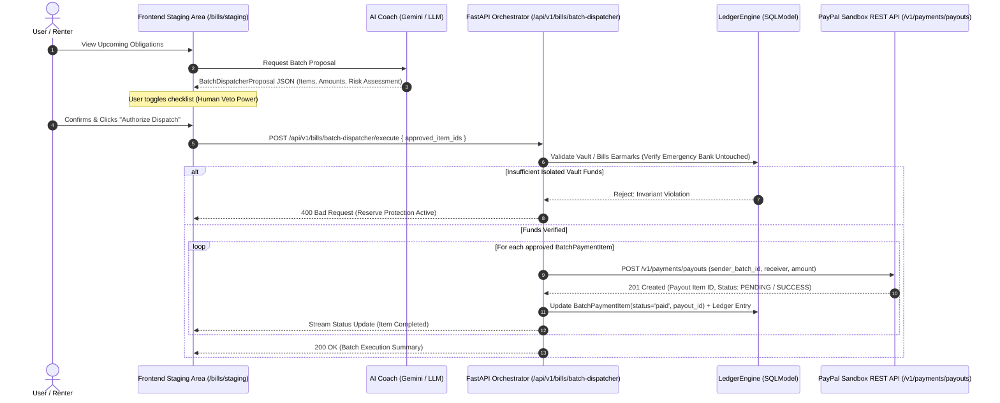

# Future Features & Post-Hackathon Roadmap (v2.0+)

> [!IMPORTANT]
> **Scope Boundary & Cut List ([problems.md](problems.md) Section 7 & Problem 8):**
> All features documented in this file are **Post-Hackathon v2.0+ Roadmap specifications** and are strictly on the **Cut List** prior to the Nov 12 hackathon submission. They receive zero engineering hours before submission so that 100% of focus remains on the core gating items in **[problems.md](problems.md)**.

This document catalogs forward-looking architectural proposals, planned extensions, and future features for **FireWallet**. Features documented here are evaluated against FireWallet's core mission: proactive financial discipline, human veto power over automated money movement, zero-float integer minor-unit accounting, and strict cryptographic/deterministic safeguards.

---

## Feature Index

| Feature | Category | Target Release | Status | Primary Doc Reference |
| :--- | :--- | :--- | :--- | :--- |
| **The Trinity Batch Dispatcher** | Agentic Financial Workflows / Bill Pay | v1.1 | Implemented / Live | [Section 1](#1-the-trinity-batch-dispatcher) |
| **Partner Multi-Sig Escalation** | Social Accountability / Security | Post-Hackathon v2.0 | Backlog | [Section 2](#2-partner-multi-sig-escalation) |
| **Predictive Cash Flow Smoothing** | Irregular Earner Intelligence | Post-Hackathon v2.1 | Backlog | [Section 3](#3-predictive-cash-flow-smoothing) |

---

# 1. The Trinity Batch Dispatcher

## 1.1 Feature Overview

The **Trinity Batch Dispatcher** is an agentic financial workflow that bridges human oversight with autonomous execution. It allows the AI Coach to parse, queue, and suggest recurring financial obligations (e.g., rent, utilities) from isolated vault funds. The user retains ultimate veto power via a staging interface, and once authorized, the agent autonomously executes the payout batch sequentially through backend APIs while maintaining strict security boundaries (protecting core emergency reserves).

---

## 1.2 Core User Flow

1. **Intelligent Ingestion:** The AI Coach reviews the user's upcoming obligations, balances, and vault constraints.
2. **The Staging Area (Human Veto Power):** The UI presents a checklist of queued payments where the user can toggle items on or off (veto specific payments).
3. **Authorized Dispatch:** Upon user confirmation, the FastAPI backend takes the approved array.
4. **Autonomous Execution:** The backend loops through the approved items, executes the transaction calls (via PayPal APIs), updates the SQLite/PostgreSQL ledger, and streams real-time status updates back to the UI.

---

## 1.3 System Architecture & Data Flow

```text
[ User Interface (React / Frontend) ]
         │ (Submits approved batch array)
         ▼
[ FastAPI Orchestrator / Backend ]
         ├── 1. Validates Vault Balances (LedgerEngine)
         ├── 2. Iterates through approved queue items
         ├── 3. Executes PayPal Payouts / Transfer APIs sequentially
         └── 4. Commits atomic updates to SQLite / PostgreSQL (SQLModel)
```

### Detailed Sequence Diagram



---

## 1.4 Technical Schema & Data Models

### A. Pydantic v2 / Structured Output Schema (AI Coach Integration)

When the AI Coach evaluates obligations or suggests a payment batch, it must adhere to this structured JSON schema to guarantee safe, deterministic backend processing (compatible with Google AI Studio / Gemini structured outputs and Groq/OpenAI tool call schemas).

```python
from pydantic import BaseModel, Field
from typing import List

class BatchPaymentItemDTO(BaseModel):
    title: str = Field(description="Name of the bill or obligation, e.g., 'Electricity Bill'")
    amount_minor: int = Field(description="Exact monetary amount in integer minor units (cents)")
    category: str = Field(description="Category of the expense, e.g., 'Utilities', 'Rent'")
    recommended: bool = Field(description="True if the AI strongly recommends paying this in the current batch")

class BatchDispatcherProposal(BaseModel):
    coach_message: str = Field(description="Empathetic, clear explanation of the proposed batch payment plan.")
    total_batch_amount_minor: int = Field(description="Sum of all recommended batch items in integer minor units (cents)")
    items: List[BatchPaymentItemDTO] = Field(description="List of queued obligations for user review and veto.")
    risk_assessment: str = Field(description="Brief security note verifying that emergency and primary bank funds remain untouched.")
```

### B. Database Model (`BatchPaymentItem` - SQLModel / SQLite & PostgreSQL)

Adheres to FireWallet's Tripartite SQLModel pattern and zero-float integer minor-unit rule:

```python
from sqlmodel import SQLModel, Field
from uuid import UUID, uuid4
from typing import Optional
from datetime import datetime, timezone

class BatchPaymentItemBase(SQLModel):
    title: str
    amount_minor: int = Field(description="Amount in integer minor units (cents)")
    category: str
    status: str = Field(default="pending_approval")  # pending_approval, approved, paid, vetoed
    paypal_payout_id: Optional[str] = None
    recipient_email: Optional[str] = None

class BatchPaymentItem(BatchPaymentItemBase, table=True):
    __tablename__ = "batch_payment_items"

    id: UUID = Field(default_factory=uuid4, primary_key=True)
    user_id: UUID = Field(index=True, foreign_key="users.id")
    created_at: datetime = Field(default_factory=lambda: datetime.now(timezone.utc))
    updated_at: datetime = Field(default_factory=lambda: datetime.now(timezone.utc))

class BatchPaymentItemRead(BatchPaymentItemBase):
    id: UUID
    user_id: UUID
    created_at: datetime
    updated_at: datetime
```

---

## 1.5 Security & Safety Guardrails

* **Blast Radius Containment:** Funds for the batch can *only* be drawn from isolated Vault or Bill buckets. Core emergency funds and main bank buffers are structurally locked against agentic modifications.
* **Human-in-the-Loop Veto Power:** The agent never dispatches payouts autonomously without explicit user confirmation of the staged checklist.
* **Idempotent Execution:** Each payment item tracks its execution state (`pending_approval` -> `approved` -> `paid`), ensuring network retries or duplicate triggers never cause double-debits (`sender_batch_id` / `PayPal-Request-Id`).
* **Deterministic Balance Check:** Execution calls `LedgerEngine.verify_bucket_sufficient(bucket='vault', amount=total)` in Python before initiating outbound PayPal requests.

---

## 1.6 API Contracts

### Endpoints

* `POST /api/v1/bills/batch-dispatcher/propose`: Generates a `BatchDispatcherProposal` from current unpaid bills and vault balances.
* `POST /api/v1/bills/batch-dispatcher/execute`: Submits an array of approved item IDs. Returns an execution summary.
* `GET /api/v1/bills/batch-dispatcher/queue`: Fetches active staged queue items and execution history.
* `POST /api/v1/bills/batch-dispatcher/stage-intent`: Stages an intent or ad-hoc payment from Quick Intent or Coach memory directly into the batch queue (`status: pending_approval`).

---

## 1.7 Dual Ingestion: Quick Intent & Persistent Memory Staging

### A. Quick Intent Batch Queuing
In addition to immediate 1-by-1 checkout, the Quick Intent interface (`QuickIntentModal.jsx`) provides an **"Add to Batch Queue"** action. This allows users to evaluate multiple prospective payments throughout the day, stage them in the queue, review them in the Batch Dispatcher Staging Area, and dispatch them all in a single consolidated run.

### B. AI Coach Memory-Driven Staging
When the AI Coach records recurring obligations or reminders in persistent memory (e.g. conversational notes on upcoming electric bills, rent, or subscriptions), the Batch Dispatcher proposal engine cross-references both the structured `bills` table and the persistent RAG memory tags (`coach_messages` / `intents`). The Coach autonomously suggests staging these detected obligations into `batch_payment_items` for user review and human veto.

---

## 2. Partner Multi-Sig Escalation
*(Planned for v2.0)*
Introduces cryptographic or dual-acknowledgment confirmation for unlocking emergency reserves when an accountability partner is linked, turning the Escape Window into a cooperative safeguard.

---

## 3. Predictive Cash Flow Smoothing
*(Planned for v2.1)*
Expands the daily rollover algorithm to ingest irregular gig payment schedules and dynamically smooth daily allowances over multi-week lulls.
